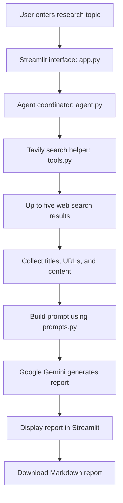

<<<<<<< HEAD
# AI RESEARCH AGENT
=======
# AI Research Agent

An AI-powered research assistant that searches the web for a topic, uses Google Gemini to turn the retrieved material into a structured report, and displays the result in a Streamlit web application. The report can be downloaded as a Markdown (`.md`) file.

## Table of Contents

- [Problem Statement](#problem-statement)
- [Objectives](#objectives)
- [Features](#features)
- [How It Works](#how-it-works)
- [Project Structure](#project-structure)
- [Technology Stack](#technology-stack)
- [Requirements](#requirements)
- [Installation and Setup](#installation-and-setup)
- [Environment Variables](#environment-variables)
- [Run the Application](#run-the-application)
- [Example Usage](#example-usage)
- [Example Report Structure](#example-report-structure)
- [Error Handling and Troubleshooting](#error-handling-and-troubleshooting)
- [Current Limitations](#current-limitations)
- [Future Improvements](#future-improvements)
- [Security Notes](#security-notes)

## Problem Statement

Researching a topic manually often requires searching multiple websites, collecting useful information, and organizing the findings into a report. This can take time and make it difficult to keep the information organized.

This project automates part of that initial research workflow by retrieving web search results and using a large language model (LLM) to create a structured report from the collected material.

## Objectives

1. Accept a research topic from the user.
2. Retrieve relevant web search results using Tavily.
3. pass the retrieved titles, URLs, and content to Google Gemini.
4. Generate a report with consistent sections.
5. Display the report in a simple web interface.
6. Allow the user to download the report in Markdown format.

## Features

- **Simple interface:** Enter a topic through a Streamlit text area.
- **Web search:** Uses Tavily and requests up to five results for the topic.
- **AI-generated report:** Uses Google Gemini to create a structured report.
- **Structured output:** Requests a title, executive summary, key findings, important statistics, sources, and conclusion.
- **Markdown download:** Download the generated report as `research_report.md`.
- **Input validation:** Warns the user if the topic is empty.
- **Configuration checks:** Displays a clear error if a required API key is missing.
- **Model retry and fallback:** On Gemini server errors, retries with delays and tries a configured fallback model.
- **Error display:** Shows errors in the Streamlit interface.

## How It Works



### Workflow

1. The user enters a topic and clicks **Generate Research Report**.
2. The app checks that the topic is not blank.
3. The agent checks for `GEMINI_API_KEY`.
4. The search helper checks for `TAVILY_API_KEY` and requests up to five results from Tavily.
5. The agent combines each result's title, URL, and content into a research context.
6. The prompt template tells Gemini to create a structured report and include source URLs.
7. The agent calls `gemini-flash-latest` and has `gemini-flash-lite-latest` configured as a fallback if server errors persist. Server errors are retried with waits of 5, 10, and 20 seconds for each configured model.
8. Streamlit displays the generated report and offers a Markdown download.

## Project Structure

```text
My-VS--Upload/
├── app.py             # Streamlit interface, input validation, display, and download
├── agent.py           # Coordinates search, prompt creation, Gemini generation, retries
├── tools.py           # Tavily web-search helper
├── prompts.py         # Instructions and expected report sections for Gemini
├── sample_input.txt   # Sample input or notes
├── test_gemini.py     # Gemini connection/testing script
├── test_search.py     # Tavily search/testing script
├── WORK_NOTES.md      # Setup, workflow, and troubleshooting notes
├── .gitignore         # Files excluded from Git
└── README.md          # Project documentation
```

## Technology Stack

| Technology | Role |
|---|---|
| Python | Main programming language |
| Streamlit | Web user interface |
| Tavily Search API | Retrieves web search results |
| Google Gemini API (`google-genai`) | Generates the research report |
| `python-dotenv` | Loads local environment variables from `.env` |
| Git and GitHub | Version control and source-code hosting |

## Requirements

- Python installed on your computer.
- Internet access.
- A Gemini API key.
- A Tavily API key.
- Git (optional, if you clone the repository).

## Installation and Setup

### 1. Clone the repository

```bash
git clone https://github.com/jayaram-A/My-VS--Upload.git
cd My-VS--Upload
```

If you already have the project open in VS Code, open a terminal in the project folder instead of cloning it again.

### 2. Create a virtual environment (recommended)

**Windows PowerShell:**

```powershell
py -m venv .venv
.\.venv\Scripts\Activate.ps1
```

If PowerShell blocks activation, use the appropriate execution-policy guidance for your own machine, or run the environment's Python directly.

### 3. Install dependencies

```bash
python -m pip install --upgrade pip
python -m pip install streamlit google-genai python-dotenv tavily-python
```

## Environment Variables

Create a file named `.env` in the project root (the same folder as `app.py`) and add your own API keys:

```dotenv
GEMINI_API_KEY=your_gemini_api_key_here
TAVILY_API_KEY=your_tavily_api_key_here
```

Replace the placeholder values with your real keys. Do not include quotation marks unless required by your environment, and do not share the keys.

The application reads these variables:

- `GEMINI_API_KEY` — used by `agent.py` for report generation.
- `TAVILY_API_KEY` — used by `tools.py` for web search.

## Run the Application

From the project root, with the virtual environment activated:

```bash
streamlit run app.py
```

Streamlit should provide a local URL in the terminal, usually `http://localhost:8501`. Open that URL in your browser if it does not open automatically.

## Example Usage

1. Enter this topic in the research-topic box:

   `Latest trends in Generative AI`

2. Click **Generate Research Report**.
3. Wait for the search and report-generation process to finish.
4. Review the generated report and its listed sources.
5. Click **Download report** to save `research_report.md`.

The actual findings depend on the live search results and the model response. Always check the source pages before relying on the report.

## Example Report Structure

The prompt requests the following sections. This is a structure example, not a claim about a particular run's findings.

```markdown
# Title

# Executive Summary

# Key Findings

# Important Statistics

# Sources

# Conclusion
```

## Screenshots

Screenshots are not currently included in this repository. To complete this section:

1. Run the application locally.
2. Capture one screenshot of the empty topic-entry interface.
3. Capture another screenshot showing a generated report (hide API keys and other private information).
4. Create a folder named `screenshots` in the repository and save the images there.
5. Add them to this section, for example:

```markdown


```

Only use these image links after adding files with those exact names.

## Error Handling and Troubleshooting

| Problem | What to check |
|---|---|
| `GEMINI_API_KEY is missing` | Confirm `.env` is in the project root and the variable name is spelled correctly. |
| `TAVILY_API_KEY is missing` | Add the Tavily key to `.env` and restart the app if needed. |
| Import or module error | Activate `.venv` and install the listed packages using `python -m pip`. |
| Search fails | Check internet access, Tavily credentials, and API limits. |
| Gemini generation fails | Check the Gemini key, service availability, model access, and quota. The current retry logic specifically catches Gemini server errors. |
| No report appears | Enter a non-empty topic and read the error displayed in the app. |

## Current Limitations

- The application requests up to five web search results; this does not guarantee comprehensive coverage of a topic.
- It passes the retrieved content to Gemini, but does not independently verify every claim against the original source.
- Prompt instructions to avoid invented statistics reduce risk but do not guarantee factual correctness.
- The current workflow is predefined; it does not implement an unlimited autonomous planning loop.
- Automated tests and measured evaluation results should be added before making claims about accuracy, reliability, or performance.
- Screenshots and a captured example output still need to be added to this repository.

## Future Improvements

- Add source validation and claim-to-source checks.
- Add automated tests for empty input, missing keys, search errors, and model errors.
- Add report-quality evaluation and record test results.
- Let users choose the number or type of sources.
- Add report export to PDF or DOCX if required.
- Add screenshots and a short demo to the README.
- Add a dependency file such as `requirements.txt` for repeatable setup.

## Security Notes

- Never commit `.env` or expose API keys in screenshots, logs, or source code.
- Keep API keys private and rotate them if they are accidentally exposed.
- Review generated claims and source links before using the report for academic, business, or other important decisions.

## Author and Repository

- **Repository:** [jayaram-A/My-VS--Upload](https://github.com/jayaram-A/My-VS--Upload)
- **Project:** AI Research Agent
>>>>>>> 0561851 (Improve project documentation)
